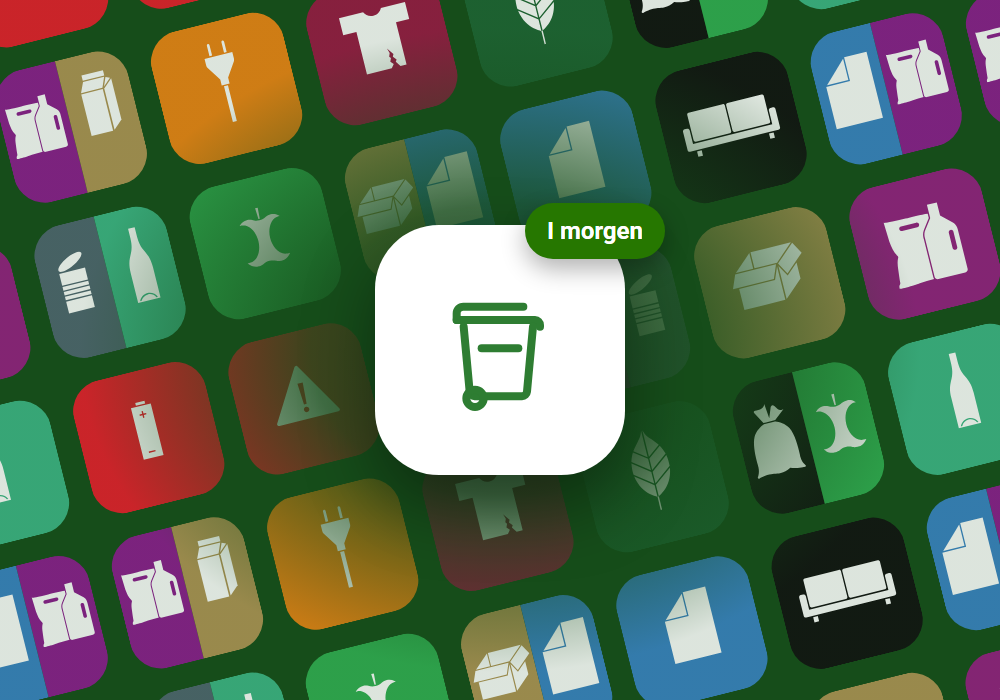
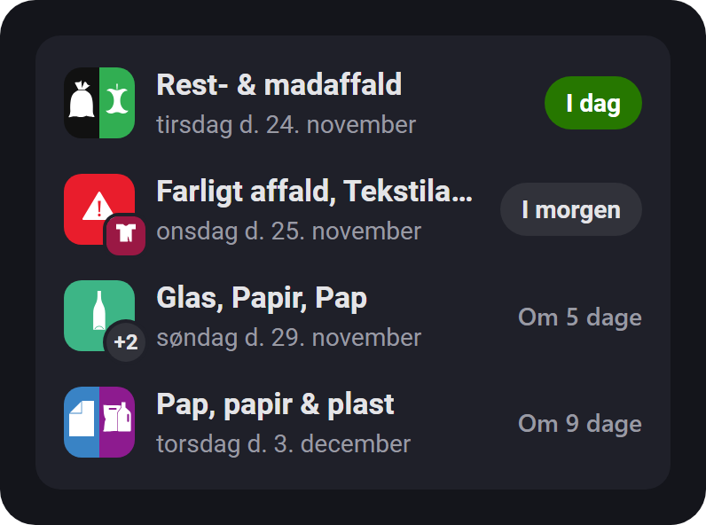
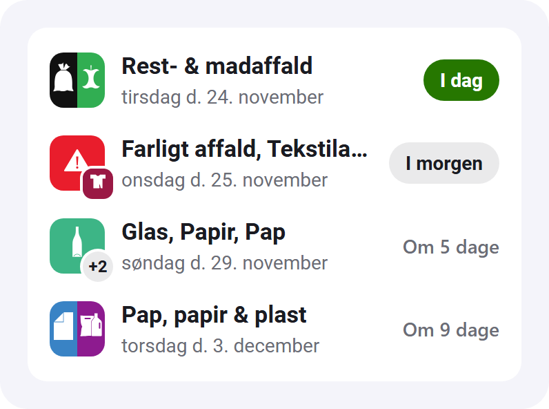
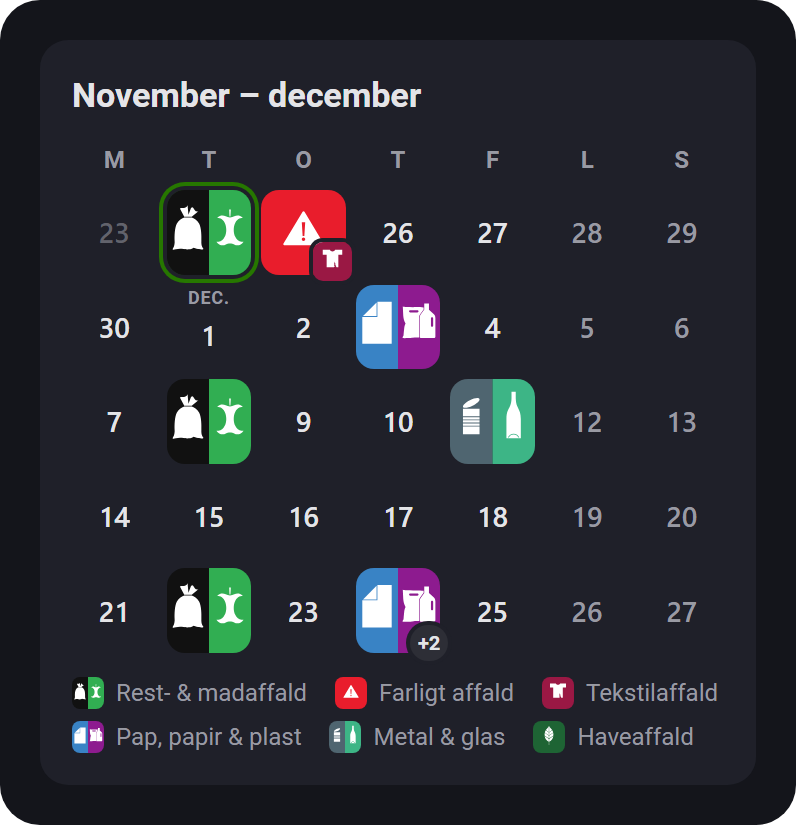
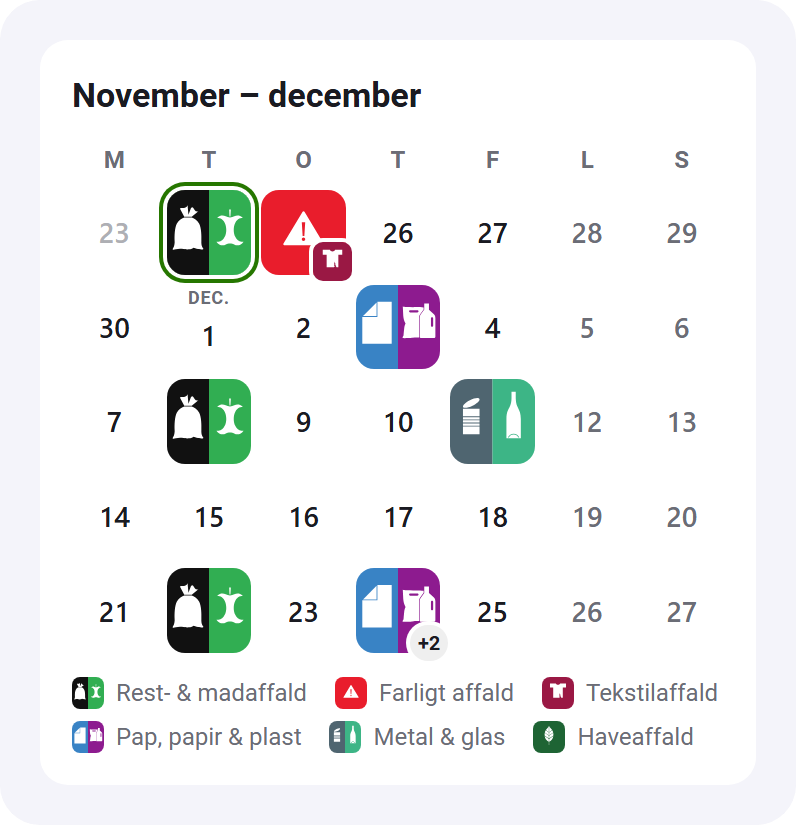
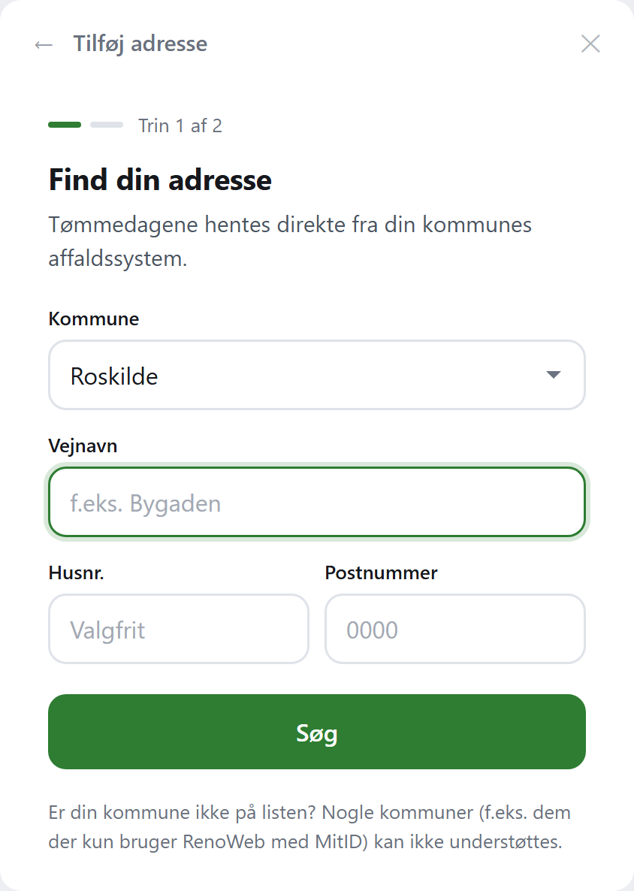
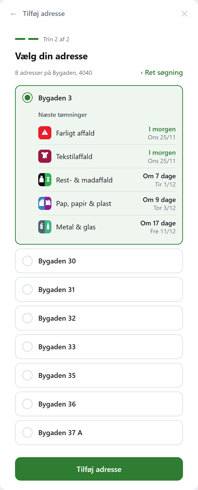

<p align="center">
  
</p>

<h1 align="center">Affald DK for Homey</h1>

<p align="center">
  <b>Never miss bin day again.</b><br>
  Waste pickup days for your Danish address in Homey: on your dashboard, in Flows and in Insights.<br>
  93 municipalities supported.
</p>

> **Built on [Affaldshåndtering DK](https://github.com/briis/affalddk)**, the Home Assistant integration by **Bjarne Riis** ([briis](https://github.com/briis)) and **TermeHansen** ([TermeHansen](https://github.com/TermeHansen)).
>
> Every Danish municipality publishes its pickup calendar differently, through 18 different systems. Working out how to read each one, and keeping up when they change, is the hard part. That's their work. This app is a port of their `pyaffalddk` library to TypeScript, with the same provider logic, the same mapping of waste type names, and their icons, used under the MIT license. If this app is useful to you, consider [buying Bjarne a coffee](https://www.buymeacoffee.com/briis).

---

## What you get

Add your address once, and Homey knows when each bin is emptied.

### Dashboard widgets

**Waste pickups** lists the coming pickup days. Today is a green pill and tomorrow a grey one. There's a compact one-line-per-day version for tight spots.

<p>
  
  &nbsp;
  
</p>

**Pickup calendar** shows the weeks ahead with the waste type icons on the pickup days.

<p>
  
  &nbsp;
  
</p>

### Reminders and automations

| Flow card | Type | What it does |
|---|---|---|
| **Pickup reminder**: *At [time], when [waste type] is collected in [N] days* | Trigger | Fires at the time you choose. Use 1 day for "the evening before" and 0 for "today". Tokens: waste types, date, days until, the provider's description. |
| **Next pickup changed** | Trigger | Fires when the next pickup moves to a new date or new waste types. |
| *[Waste type] is collected in exactly [N] days* | Condition | 0 = today, 1 = tomorrow. Works with *Any waste type*. |
| *[Waste type] is collected within [N] days* | Condition | For example "is anything collected in the next two days?". |
| **Refresh pickup data** | Action | Fetches the calendar now. It's refreshed automatically every night. |

**Examples**

- *At 19:00, when Pap & papir is collected in 1 day* → send a push message: "Put the paper bin out tonight 🗑️"
- *At 07:00, when any waste type is collected in 0 days* → flash the hallway light green.
- Every morning, *if Restaffald is collected within 1 day* → show it on your wall display.

### On the device

Each address becomes a device, with values you can use anywhere in Homey:

| Value | Example |
|---|---|
| Next pickup | Rest- & madaffald |
| Next pickup date | Tir 25/11 (i morgen) |
| Days until next pickup | 1 |
| Days until each waste type, e.g. *Pap & papir*, *Metal & glas* | 9 |

The day counts are logged in Insights. The device's settings let you choose when "next pickup" moves on to the following pickup on a pickup day (15:00 by default, as most bins are emptied by then).

## Getting started

### 1. Install

Affald DK needs a **Homey Pro** with Homey 12.2 or newer.

**[Install the test version from the Homey App Store](https://homey.app/en-dk/app/com.thomassidor.affalddk/test/)** (1.0.0, in testing).

<details>
<summary>Or install from source</summary>

```bash
npm install -g homey        # Homey's command line tool (needs Node.js)
homey login
git clone https://github.com/thomassidor/homey-affalddk.git
cd homey-affalddk
npm install
homey app install
```

</details>

### 2. Add your address

In the Homey app: **Devices → + → Affald DK → Address**.

<p>
  
  &nbsp;
  
</p>

1. Your municipality is picked from Homey's location. Enter your street, house number and postcode.
2. Tap your address. You'll see its next pickups straight away, so you know it's the right one.
3. Tap **Add address**.

You can add several addresses, such as a summer house.

### 3. Put it to work

Add the **Waste pickups** or **Pickup calendar** widget to a dashboard and pick your address in its settings. Then make a Flow with the **Pickup reminder** card.

## Supported municipalities

93 of Denmark's 98 municipalities. Each one was checked against its real waste system on 24 November 2026.

<details>
<summary><b>See all municipalities by waste system</b></summary>

| Waste system | Municipalities |
|---|---|
| Perfect Waste | Allerød, Ballerup, Faxe, Frederiksberg, Frederikssund, Gladsaxe, Greve, Gribskov, Guldborgsund, Halsnæs, Helsingør, Hillerød, Horsens, Hvidovre, Høje-Taastrup, Hørsholm, Kalundborg, Køge, Lejre, Lolland, Lyngby-Taarbæk, Næstved, Odsherred, Ringkøbing-Skjern, Roskilde, Rudersdal, Slagelse, Solrød, Stevns, Tårnby, Vejen |
| RenoWeb | Aabenraa, Aalborg, Billund, Bornholm, Brøndby, Brønderslev, Dragør, Egedal, Esbjerg, Fredensborg, Gentofte, Glostrup, Hjørring, Jammerbugt, Kerteminde, Mariagerfjord, Randers, Rødovre, Samsø, Svendborg, Sønderborg, Varde, Vordingborg |
| AffaldOnline | Assens, Faaborg-Midtfyn, Favrskov, Holbæk, Langeland, Morsø, Rebild, Vejle, Viborg, Ærø |
| Open Experience | Holstebro, Lemvig, Nordfyns, Skive, Struer |
| Vest Forbrænding | Albertslund, Furesø, Herlev, Ishøj, Vallensbæk |
| AffaldOnline (PDF calendar) | Fanø, Middelfart, Nyborg, Sorø |
| Open Experience Live | Fredericia, Thisted |
| RenoDjurs | Norddjurs, Syddjurs |
| RenoSyd | Odder, Skanderborg |
| AffaldOnline (web calendar) | Silkeborg |
| Affaldsweb | Herning |
| Ikast-Brande | Ikast-Brande |
| Infovision | Kolding |
| Kredsløb | Aarhus |
| Københavns Kommune | København |
| Odense Renovation | Odense |
| Provas | Haderslev |
| WasteWatch (Tønder Forsyning) | Tønder |

</details>

**Is your municipality missing?** A few municipalities only show pickup days after a MitID login, which an app can't do. Support for new systems is added in [the original project](https://github.com/briis/affalddk) first, and this app follows it.

## Questions

**How often is the data updated?**
Once a night between 03:00 and 06:00, and whenever you use the *Refresh pickup data* card. The "days until" values count down every hour without fetching anything.

**A waste type is missing on my device.**
Each municipality names its bins differently ("240 L Genbrug 2-kammer", "Papir/Pap"…). The app recognises hundreds of names, but a new one is skipped until it's added to the mapping. Please report it in [the original project's issues](https://github.com/briis/affalddk/issues) along with your municipality, so every user of either app benefits. It then reaches this app with the next update.

**The device says it can't reach the waste provider.**
Some systems have occasional outages. The app keeps showing the last calendar it got and tries again: after 5 minutes, 15 minutes, an hour, and then every 3 hours.

**What does the app send, and where?**
Homey talks directly to three kinds of service, with no server of ours in between:

- **Your municipality's waste system** gets your address search and your address, to look up your pickup days.
- **The national address register** (Klimadatastyrelsen's Adressevælger) gets the address search for a few systems (Aarhus, Odder, Skanderborg and Tønder).
- **dawa.companydata.dk** gets Homey's location when you add an address, to suggest your municipality.

There's no account and no tracking.

## På dansk

Affald DK henter tømmekalenderen for din adresse direkte fra kommunens affaldssystem. Den viser den på dit Homey-dashboard som en liste eller en kalender, og kan minde dig om at sætte skraldespanden ud aftenen før. 93 kommuner understøttes. App'en bygger på [Affaldshåndtering DK](https://github.com/briis/affalddk) af Bjarne Riis og TermeHansen.

## Development

See [docs/development.md](docs/development.md) for the code layout and tests. It also covers how to pull in upstream changes and render the graphics. Bug reports and pull requests are welcome in [this repository's issues](https://github.com/thomassidor/homey-affalddk/issues). Missing waste types belong upstream, as described above.

## Credits and license

- **[Affaldshåndtering DK](https://github.com/briis/affalddk)** by Bjarne Riis and TermeHansen: the provider integrations, the waste type mapping and the waste type icons, which this app ports (MIT).
- Address search uses [Klimadatastyrelsen's Adressevælger](https://adressevaelger.dk). The municipality suggestion uses [dawa.companydata.dk](https://dawa.companydata.dk).
- Homey app by Thomas René Sidor.

Released under the [MIT license](LICENSE), with the original project's copyright notice kept.
