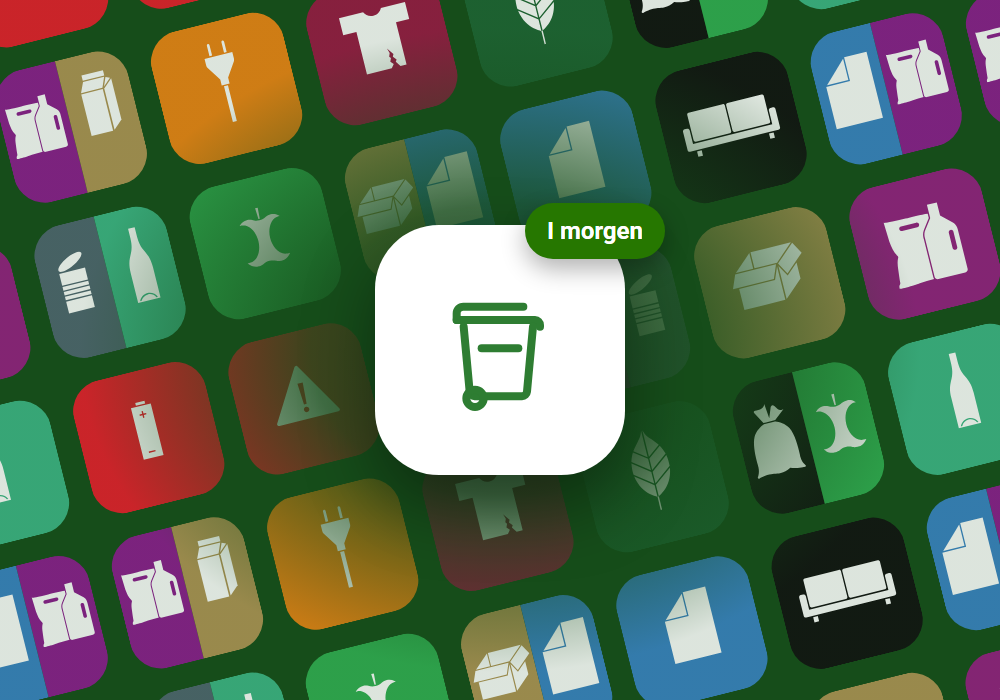
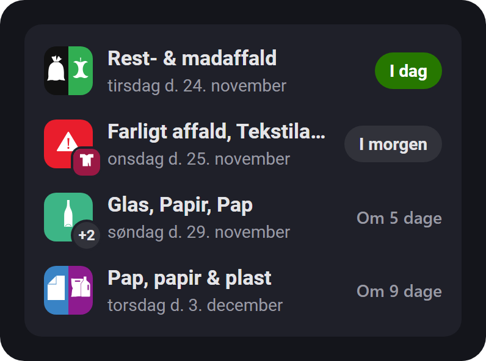
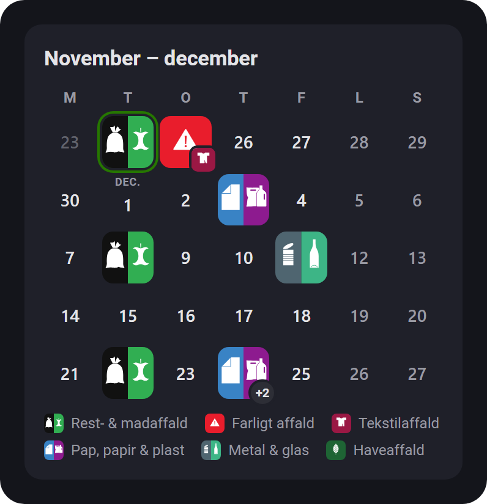
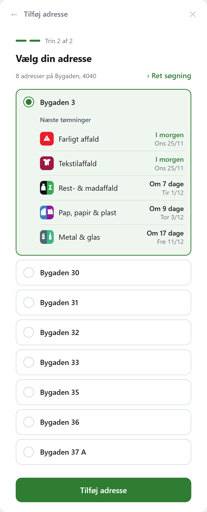

**Title:** [APP][Pro] Affald DK – waste pickup days for 93 Danish municipalities

---

Hi all 👋

**Affald DK** puts your bin days in Homey. Add your address, and Homey knows when each waste type is collected: on your dashboard, in Flows and in Insights. It covers 93 of Denmark's 98 municipalities.

**Version 1.0.0 is out in testing:** https://homey.app/en-dk/app/com.thomassidor.affalddk/test/

### Standing on the shoulders of Affaldshåndtering DK

This app is a port of [Affaldshåndtering DK](https://github.com/briis/affalddk), the Home Assistant integration by **Bjarne Riis** and **TermeHansen**. Danish municipalities publish their pickup calendars through 18 different systems. Working out how to read each of them, and keeping up when they change, is the hard part, and that's their work. Affald DK carries their library over to Homey, with the same provider logic, the same mapping of waste type names, and their icons (MIT license). If you find this useful, consider [buying Bjarne a coffee](https://www.buymeacoffee.com/briis).

### What you get

**Two dashboard widgets**

*Waste pickups* lists the coming pickup days. Today is green, tomorrow grey, and there's a compact version:

*Pickup calendar* shows the weeks ahead with the waste type icons on the pickup days:

Both follow Homey's light and dark theme.

**Flow cards**

- ⏰ **Pickup reminder** (trigger): *At [time], when [waste type] is collected in [N] days*. For example "at 19:00, when Pap & papir is collected in 1 day".
- 🔁 **Next pickup changed** (trigger)
- ❓ *[Waste type] is collected in exactly [N] days* and *… within [N] days* (conditions, both with "Any waste type")
- 🔄 **Refresh pickup data** (action)

**A device per address**, with the next pickup, its date, and "days until" for each waste type. You can use them as Flow tokens, and they're logged in Insights. Add as many addresses as you like, for example a summer house.

### Adding your address

Your municipality is picked from Homey's location. Type your street, house number and postcode, and tap your address. You'll see its next pickups before adding it, so you know you've got the right one.

### Supported municipalities

All 93 were checked against their real waste systems before this release: Perfect Waste, RenoWeb, AffaldOnline, Open Experience, Vest Forbrænding, RenoDjurs, RenoSyd, Provas, WasteWatch, Kredsløb (Aarhus), Odense Renovation, København, Herning, Ikast-Brande, Kolding, and more. The full list is in the [README](https://github.com/thomassidor/homey-affalddk#supported-municipalities).

A few municipalities only show pickup days behind a MitID login, which an app can't do.

### Feedback welcome

This is a test version, so please tell me how it works for your address. Especially useful:

- **A waste type is missing on your device.** Municipalities name their bins very differently ("240 L Genbrug 2-kammer" …), and an unknown name is skipped. Post your municipality and the name, and I'll get it added upstream, so Home Assistant users benefit too.
- **Your address can't be found**, or pickups look wrong. Please include your municipality.
- Ideas for Flow cards or the widgets.

Bugs and ideas are also welcome on [GitHub](https://github.com/thomassidor/homey-affalddk/issues).

### På dansk

Affald DK henter tømmedagene for din adresse direkte fra kommunens affaldssystem. Du får en liste og en tømmekalender på dit dashboard, og kan få en påmindelse aftenen før, når en spand skal stilles ud. 93 kommuner understøttes. Prøv testversionen, og skriv gerne her, hvis noget mangler eller ikke virker for din adresse.

---

**Links**

- Test version: https://homey.app/en-dk/app/com.thomassidor.affalddk/test/
- Source and full README: https://github.com/thomassidor/homey-affalddk
- The original Home Assistant integration: https://github.com/briis/affalddk
